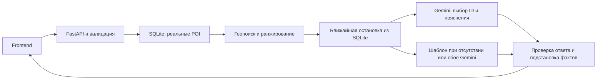

# Smart City AI — ASTANA GO AI

RAG-гид по Астане для туристов и жителей города. Проект для хакатона **Build with AI**, кейс **НИЦ Smart City**: по выбранной точке, пожеланию и доступному времени предлагает реальные места из OpenStreetMap, объясняет выбор и подсказывает, что там сделать.

Это основной README проекта: установка, запуск frontend и backend в двух терминалах, тесты по ТЗ, формулы и ограничения. Состояние кода проверено **19 октября 2026 года**.

## Что реализовано

- Автоматический сбор POI из Overpass в SQLite: названия, координаты, категории, исходные теги, часы, контакты и доступность, если они есть в OSM. Повторный сбор обновляет записи без дублей, использует кеш и ограниченные повторы при временных сбоях.
- Геопоиск и ранжирование по времени, расстоянию и пожеланию. Локальное распознавание семи категорий в запросах на русском, казахском и английском; явный фильтр категорий имеет приоритет.
- Gemini получает до 12 реальных кандидатов. Сервер проверяет ID и очевидные неподтверждённые утверждения; возвращает до трёх альтернатив. При ошибке Gemini сохраняются реальные места с шаблонными пояснениями.
- Часы OSM с `is_open_now: true/false/null`, оговорка об актуальности, `source`, `generated_by`, `query_context`, предупреждение о превышении бюджета.
- «Показать ещё»: `exclude_ids`, `has_more`, добавление карточек без повторов. Иллюстрации категорий — локальные SVG.
- Ближайшая остановка автобуса/ЛРТ/трамвая в радиусе 500 м от места: отдельная таблица SQLite, поле `nearest_transit_stop`, вывод в карточке и деталях. Название и номера маршрутов показываются только при наличии данных.
- Frontend: форма, геолокация по кнопке, ручные координаты, ориентиры и выбор точки на карте, карточки, подробности, карты, состояния ошибок, интерфейс RU/KZ/EN.

Язык пояснений API — **`ru` или `kk`**. Английское пожелание распознаётся, но английский интерфейс запрашивает пояснения на русском и сообщает об этом. Доступность — исходный тег OSM; серверного фильтра особых потребностей пока нет. Полный экран согласия, production-развёртывание, реальные фотографии мест и транспортный роутинг не реализованы.

Последний проверенный набор данных: **601 POI** и **1 365 объектов остановок** (1 293 автобусных, 72 ЛРТ). Это снимок состояния, а не обещание такого количества при новом сборе. Одна физическая остановка может иметь несколько OSM-объектов. SQLite и кеш в Git не входят.

## Архитектура и технологии



Сбор данных запускается отдельными командами. Во время поиска Overpass не вызывается. Retrieval использует SQL, Haversine и скоринг; embeddings и векторная БД не используются.

- **Backend:** Python 3.11+, FastAPI, Pydantic 2, pydantic-settings, Uvicorn, SQLite; `opening-hours-py` и `tzdata`; Gemini REST API через `urllib`.
- **Frontend:** HTML/CSS/JavaScript, без npm-сборки. Leaflet и тайлы OSM, Google Maps; виджеты Open-Meteo и GDELT, внешние ресурсы cdnjs и Google Fonts.
- **Тесты:** pytest, httpx2, Ruff; встроенный `node:test` для frontend. Проверено на Python **3.12.14** и Node.js **24.19.0**. Node нужен для тестов, не для запуска сайта.

## Установка — один раз

Нужны Git, Python 3.11+ с `venv` и `pip`. Для первой загрузки POI и остановок нужен интернет. Ключ Gemini необязателен: без него доступны реальные POI с помеченными шаблонными пояснениями.

Все команды выполняются **из корня репозитория**, где лежат `README.md`, `index.html` и папка `backend`.

```sh
git clone https://github.com/kasestuck/SmartCityAI.git
cd SmartCityAI
```

Если проект уже скачан, откройте терминал в его папке. Ниже описана текущая рабочая версия: до публикации незакоммиченных изменений удалённая `main` может отставать.

### Windows PowerShell

```powershell
python --version
python -m venv .venv
.\.venv\Scripts\python.exe -m pip install -r backend/requirements-lock.txt
if (-not (Test-Path -LiteralPath backend/.env)) { Copy-Item backend/.env.example backend/.env }
```

Если `.venv` уже создана, используйте её, не создавая заново. Если `python` не найден, установите Python с добавлением в PATH и откройте новый терминал. `py -3` подходит только при установленном Python Launcher. Пока создание окружения не завершилось успешно, команды `.venv` выполнять нельзя. Активация окружения не требуется.

### Linux / macOS

```sh
python3 --version
python3 -m venv .venv
./.venv/bin/python -m pip install -r backend/requirements-lock.txt
[ -f backend/.env ] || cp backend/.env.example backend/.env
```

Lock-файл фиксирует проверенные зависимости вместе с тестовыми инструментами. Файлы диапазонов версий: [requirements.txt](backend/requirements.txt) и [requirements-dev.txt](backend/requirements-dev.txt).

### Настроить backend/.env

Существующий `.env` не перезаписывайте. Все параметры и комментарии находятся в [backend/.env.example](backend/.env.example). Основные значения:

```dotenv
DATABASE_PATH=data/poi.sqlite3
CORS_ORIGINS=["http://localhost:5173"]
GEMINI_API_KEY=
GEMINI_MODEL=gemini-3.8-flash
GEMINI_TIMEOUT_SECONDS=8
POI_CACHE_PATH=cache/overpass.json
TRANSIT_CACHE_PATH=cache/transit-overpass.json
POI_CACHE_TTL_SECONDS=86400
```

Укажите собственный ключ только в `GEMINI_API_KEY` локального файла. Имя модели выше взято из примера проекта; её доступность и квота зависят от аккаунта. Пути данных разрешаются относительно `backend/`. Переменные окружения процесса имеют приоритет над `.env`. Ключ не должен попадать во frontend или Git.

### Собрать данные

В PowerShell из корня проекта:

```powershell
.\.venv\Scripts\python.exe -m backend.scripts.collect_poi
.\.venv\Scripts\python.exe -m backend.scripts.collect_transit
```

В Linux/macOS замените `.\.venv\Scripts\python.exe` на `./.venv/bin/python`.

Дождитесь успешного завершения обеих команд: они печатают `received`, `saved`, `skipped` и источник `cache`/`network`. `collect_poi` наполняет таблицу мест, `collect_transit` — отдельную таблицу остановок. При ошибке существующие данные сохраняются; ошибка не означает успешного обновления. Для принудительного обращения к Overpass добавьте `--force`.

При переносе проекта на другой компьютер сбор нужен снова: база и кеш игнорируются Git. Без POI выдача будет пустой; без остановок новое поле будет `null`. Общий слой мест на карте использует отдельный [публичный снимок](data/poi-astana.json); обновляется командой `python tools/build_poi_snapshot.py`, которая также обращается к Overpass.

## Ежедневный запуск — два терминала

В обоих терминалах рабочая папка — корень `SmartCityAI`. После установки зависимости и данные пересобирать при каждом старте не нужно.

### Терминал 1 — backend, порт 8001

Windows PowerShell:

```powershell
.\.venv\Scripts\python.exe -m uvicorn backend.main:app --host 127.0.0.1 --port 8001 --no-access-log
```

Linux/macOS:

```sh
./.venv/bin/python -m uvicorn backend.main:app --host 127.0.0.1 --port 8001 --no-access-log
```

Оставьте терминал работающим. Порт **8001** соответствует `API_BASE_URL` в [js/config.js](js/config.js). При изменении порта нужно согласовать оба значения. `--no-access-log` отключает access log Uvicorn, но не журналы сторонних серверов.

### Терминал 2 — frontend, порт 5173

Windows PowerShell:

```powershell
.\.venv\Scripts\python.exe tools/serve_frontend.py
```

Linux/macOS:

```sh
./.venv/bin/python tools/serve_frontend.py
```

Откройте **[http://localhost:5173/?mock=0#/guide](http://localhost:5173/?mock=0#/guide)**. Выберите точку, введите пожелание и запустите поиск. Этот origin разрешён CORS по умолчанию; адрес `http://127.0.0.1:5173` имеет другой origin. Используйте `tools/serve_frontend.py`: он выдаёт только публичные файлы и закрывает `.env`, SQLite и `.git`. Открытие `index.html` через `file://` не заменяет запуск сервера.

Остановка появляется в карточке и подробностях, если API нашёл её в пределах 500 м от самого места. Для просмотра нужен реальный режим: старые mock-фикстуры остановок не содержат.

Для остановки нажмите **Ctrl+C** в каждом терминале. После изменений Python перезапустите backend; после изменений JS/CSS обновите страницу **Ctrl+F5** и повторите поиск. Результаты хранятся в памяти вкладки и исчезают при перезагрузке.

### Проверка работы и частые проблемы

- Откройте [health](http://localhost:8001/api/health): ожидается `{"status":"ok"}`. Это проверка чтения таблицы POI, не ключа Gemini и не количества записей.
- [Swagger UI](http://localhost:8001/docs) позволяет отправить запрос без отдельного терминала; [OpenAPI](http://localhost:8001/openapi.json) описывает текущую схему.
- Если порт занят, проверьте уже открытые терминалы. Не запускайте второй экземпляр того же сервера на этом порту.
- Пустая выдача: проверьте успешный сбор, выбранную точку и категории. Данные ограничены Астаной, а рядом может не быть подходящих POI.
- Gemini вернула ошибку или квота закончилась: API может ответить HTTP 200 с `generated_by="fallback_template"`. Это штатное поведение; HTTP 200 не доказывает успешной генерации Gemini.
- Если Python сообщает `PermissionError` именно для унаследованного `SSLKEYLOGFILE`, выполните в этом PowerShell `$env:SSLKEYLOGFILE=$null` и повторите команду.

Для демонстрации интерфейса без API: [mock-режим](http://localhost:5173/?mock=1#/guide). Сценарии `?mock=empty`, `422`, `429`, `500`, `503`, `503-empty`, `html`, `network`, `timeout` показывают пустую выдачу и ошибки. Mock не проверяет настоящие SQLite, Gemini или остановки. `?mock=0` принудительно включает реальный API.

## API и пример запроса

| Метод | Путь | Назначение |
| --- | --- | --- |
| GET | `/api/health` | Доступность SQLite/таблицы POI |
| POST | `/api/recommendations` | 0–3 рекомендации, применённые параметры, язык и `has_more` |

Полная схема: [docs/api-contract.md](docs/api-contract.md). Координаты WGS84, время 15–240 целых минут, `query` 1–500 символов, транспорт только `walking`. `categories`, `language` (`ru`/`kk`) и `exclude_ids` необязательны; неизвестные поля запрещены.

Пример тела для Swagger:

```json
{
  "latitude": 51.1283,
  "longitude": 71.4305,
  "query": "Хочу тихое место с кофе и розеткой недалеко от меня",
  "duration_minutes": 60,
  "transport": "walking",
  "categories": ["cafe"],
  "language": "ru",
  "exclude_ids": []
}
```

Пример отправки из свободного PowerShell при работающем backend:

```powershell
$body = @{
    latitude = 51.1283
    longitude = 71.4305
    query = 'Хочу кофе поблизости'
    duration_minutes = 60
    transport = 'walking'
    categories = @('cafe')
    language = 'ru'
} | ConvertTo-Json
Invoke-RestMethod -Uri http://localhost:8001/api/recommendations -Method Post -ContentType 'application/json; charset=utf-8' -Body ([System.Text.Encoding]::UTF8.GetBytes($body))
```

Для «Показать ещё» повторяются параметры поиска, а в `exclude_ids` передаются ID всех уже показанных карточек. Новые карточки добавляются; `has_more=false` означает конец выдачи. Названия, координаты и часы берутся из SQLite; `generated_by` относится к `reason` и `suggested_action`. Время и расстояния рассчитывает backend.

## Тестирование по ТЗ

Сценарии сверены с `BACKEND_SPEC_Smart_City.pdf` и кейсом НИЦ Smart City из `FINAL Задачи_хакатона.docx.pdf`, предоставленными команде. Примеры названий и событий в ТЗ не добавляются в рабочую базу как факты.

### Запуск автоматических тестов

Из корня проекта в свободном терминале; серверы для тестов не нужны:

```powershell
.\.venv\Scripts\python.exe -m pytest backend/tests -q
node --test tests/frontend-contract.test.cjs
.\.venv\Scripts\python.exe -m ruff check backend tools
.\.venv\Scripts\python.exe -m pip check
```

Linux/macOS: замените путь Python на `./.venv/bin/python`. Для JS-тестов установите Node.js; `npm install` не требуется. Если временная папка pytest недоступна, добавьте `-p no:cacheprovider --basetemp .test-tmp-unique`, выбрав новый отдельный каталог: pytest управляет его содержимым.

Свежий прогон **19.10.2026** на текущем рабочем коде:

```text
Backend:  597 passed, 8 skipped in 38.68s
Frontend: 29 passed, 0 failed
Ruff:     All checks passed!
pip check: No broken requirements found.
```

Восемь пропусков — существующие тесты символических ссылок: Windows не выдала право на их создание (`WinError 1314`). При проверке использовались отдельный временный каталог через `--basetemp` и `-p no:cacheprovider`. Автотесты работают с временными SQLite и контролируемыми ответами внешних сервисов; они не расходуют квоту Gemini и не доказывают его доступность перед демо.

### Пять пользовательских сценариев из кейса

Используйте живой сайт без `?mock=1` либо Swagger. Во всех сценариях `transport="walking"`, `language="ru"`; координаты — заданные ориентиры из конфигурации проекта, не геолокация пользователя. Для S5 передайте `categories: []`. Для остальных возьмите категории из таблицы.

| № | Запрос и входные параметры | Ожидаемый результат / критерий проверки |
| --- | --- | --- |
| S1 | «Я сейчас возле Mega Silk Way, хочу прогуляться 30–60 минут — что посоветуете?»; точка `51.0893, 71.4093`; 60 мин; `park, attraction, viewpoint` | Реальные места разрешённых категорий, объяснение и действие; время в бюджете либо явное предупреждение. Расстояние по прямой. |
| S2 | «Хочу тихое место с кофе и розеткой недалеко от меня»; ЭКСПО `51.0890, 71.4155`; 60 мин; `cafe` | Кафе рядом; тишина и розетки не объявляются подтверждёнными без сведений. Неизвестные условия предлагается уточнить. |
| S3 | «Еду с ребёнком — где рядом есть детские площадки или музей с интерактивами?»; Байтерек `51.1283, 71.4305`; 120 мин; `playground, museum, park` | Подходящие категории; интерактивы и доступность не выдумываются. Может быть меньше трёх мест при нехватке данных. |
| S4 | «Я турист, у меня 2 часа перед вылетом: что можно посмотреть поблизости?»; аэропорт `51.0222, 71.4669`; 120 мин; `attraction, museum, viewpoint` | Близкие реальные места либо честный пустой результат. Обратная дорога, путь в аэропорт и предполётные процедуры не входят в оценку; обещания успеть на рейс недопустимы. |
| S5 | «Ищу необычную ночную активность»; Хан Шатыр `51.1323, 71.4036`; 120 мин; без фильтра категорий | Реальные POI, `is_open_now` по расписанию либо `null`, оговорка о часах. Ночные события и фактическая работа не подтверждаются; закрытые по расписанию места могут остаться в выдаче. |

**Общие критерии:** HTTP 200, от 0 до 3 карточек; каждый ID присутствует в базе, без дублей; у непустого ответа есть «почему», «что делать», расстояние и оценка времени. `source="OpenStreetMap"` помечает факты, `generated_by` — происхождение пояснения. Отсутствующие сведения остаются `null`; `query_context` показывает применённые параметры. При нехватке POI пустой массив допустим по backend-ТЗ — система не создаёт места для заполнения карточек.

Это воспроизводимые приёмочные сценарии. Их полный ручной прогон в браузере и скриншоты пока не отмечены завершёнными: журнал [сценариев сдачи](docs/submission/03-test-scenarios.md) содержит `TODO`. Успех автоматических тестов не заменяет этот прогон.

### Автоматические проверки требований и ошибок

| Требование / проверка | Ожидание | Где проверяется |
| --- | --- | --- |
| Корректный запрос, health, CORS | Схема ответа соответствует контракту; health читает таблицу POI | [test_api.py](backend/tests/test_api.py), [test_api_rag.py](backend/tests/test_api_rag.py) |
| Плохие координаты, время 14, пустой текст, `driving` | HTTP 422 и `VALIDATION_ERROR`, без traceback | [test_api.py](backend/tests/test_api.py) |
| Пустая база / неизвестная категория / нет места в радиусе | HTTP 200, пустая выдача; места не выдумываются | [test_api_rag.py](backend/tests/test_api_rag.py), [test_geo_search.py](backend/tests/test_geo_search.py) |
| Gemini недоступна, нет ключа, неверный JSON | Реальные POI и `generated_by="fallback_template"`, HTTP 200 | [test_gemini.py](backend/tests/test_gemini.py), [test_api_rag.py](backend/tests/test_api_rag.py) |
| Gemini возвращает выдуманный или повторный ID | Неизвестный ID отбрасывается, дублей нет | [test_rag.py](backend/tests/test_rag.py), [test_api_rag.py](backend/tests/test_api_rag.py) |
| «Открыто сейчас» без сведений / неподтверждённые удобства | Очевидные неподтверждённые утверждения заменяются шаблоном | [test_rag.py](backend/tests/test_rag.py) |
| Часы и прозрачность | `true/false/null` по OSM; источник текста и контекст запроса присутствуют | [test_opening_hours.py](backend/tests/test_opening_hours.py), [test_rag.py](backend/tests/test_rag.py) |
| «Кофе рядом», 15 минут, кафе в пешем радиусе | Одно кафе с полной оценкой и `budget_warning`, даже если обычный бюджет не подходит | [test_geo_search.py](backend/tests/test_geo_search.py), [test_api_rag.py](backend/tests/test_api_rag.py) |
| Семь категорий × RU/KK/EN без `categories` | 21 случай возвращает запрошенную категорию; ещё 12 естественных формулировок и проверка UTF-8 | [test_query_intent.py](backend/tests/test_query_intent.py) |
| Повторный сбор, кеш, сбой Overpass | Нет дублей; исходная дата кеша сохраняется; сбой не уничтожает базу | [test_collector.py](backend/tests/test_collector.py), [test_database.py](backend/tests/test_database.py) |
| Техническое название вместо имени | Сырые ID/ref и кодоподобные имена не становятся названиями карточек | [test_poi_names.py](backend/tests/test_poi_names.py), [test_pagination.py](backend/tests/test_pagination.py) |
| Все найденные ID исключены | Пустая выдача и `has_more=false`; «Показать ещё» не повторяет карточки | [test_pagination.py](backend/tests/test_pagination.py), [frontend-contract.test.cjs](tests/frontend-contract.test.cjs) |
| Остановка рядом / далеко / отсутствует | Корректное расстояние от POI до остановки в пределах 500 м либо `null` | [test_transit_api.py](backend/tests/test_transit_api.py), [test_transit_collector.py](backend/tests/test_transit_collector.py) |
| Выдуманные номера маршрутов или ожидание | Неподтверждённые транспортные фразы заменяются шаблоном | [test_transit_api.py](backend/tests/test_transit_api.py) |
| Frontend: карточки, подробности, языки, ошибки, подгрузка, остановки | Поля не теряются, текст выводится безопасно, новые карточки добавляются без дублей | [frontend-contract.test.cjs](tests/frontend-contract.test.cjs) |
| Раздача frontend-файлов | `.env`, база и служебные каталоги недоступны по HTTP | [test_frontend_server.py](backend/tests/test_frontend_server.py) |

Для ручного отказа геолокации нажмите соответствующую кнопку и запретите доступ: должны остаться выбор точки на карте, ориентир и ввод координат. Для проверки пустых полей убедитесь, что сайт не печатает `undefined`/`null`. Для пагинации нажмите «Показать ещё» и проверьте добавление карточек без повторов. Включение KZ должно дать `language="kk"`; EN оставляет русский язык пояснений с явной пометкой.

Результаты настоящих сетевых проверок: [demo-results.json](docs/demo-results.json), [transit-demo-results.json](docs/transit-demo-results.json). Последняя транспортная проверка получила HTTP 200 с остановками и шаблонными пояснениями; отдельный запрос Gemini вернул **429 RESOURCE_EXHAUSTED**. В этой проверке успешная живая генерация не подтверждена. Квоту нужно проверять отдельно перед демонстрацией.

## Формулы расстояния, времени и ранжирования

Источник формул — [backend/services/geo_search.py](backend/services/geo_search.py). Это оценки одного подхода к одному месту и посещения. Три карточки предлагаются как альтернативы, а не как последовательность посещений.

### 1. Расстояние Haversine

Широты `φ₁, φ₂` и разность долгот `Δλ` переводятся в радианы. Разность долгот приводится к диапазону −180…180 градусов до перевода. Радиус Земли `R = 6 371 008,8 м`.

```text
a = sin²((φ₂ − φ₁) / 2) + cos(φ₁) · cos(φ₂) · sin²(Δλ / 2)
d = 2 · R · asin(√clamp(a, 0, 1))
```

`d` — расстояние по прямой на сфере. `clamp` ограничивает вычисленное значение от 0 до 1 для защиты от ошибок округления.

### 2. Время на дорогу и посещение

```text
t_walk  = ceil(1,3 · d / 75)
t_total = t_walk + t_visit
```

`75 м/мин` — принятая скорость ходьбы; `1,3` — приблизительная поправка на непрямой путь; `ceil` округляет минуты вверх. Фактический путь по дорогам не строится.

| Категория | `t_visit`, мин |
| --- | ---: |
| cafe | 20 |
| restaurant | 45 |
| park | 20 |
| museum | 45 |
| attraction | 20 |
| viewpoint | 10 |
| playground | 20 |

Пример: кафе в 300 м → `ceil(1,3 × 300 / 75) + 20 = 6 + 20 = 26 мин`. Обратная дорога и ожидание транспорта не входят.

### 3. Радиус и короткий бюджет

Для бюджета `T` и применённых категорий (если фильтр отсутствует и намерение не распознано, используются все семь категорий):

```text
r          = max(0, T − min(t_visit)) · 75 / 1,3
r_fallback = T · 75 / 1,3
```

SQL отбирает географический прямоугольник для `r_fallback`, затем Haversine уточняет круг. Обычные кандидаты должны удовлетворять `t_total ≤ T`. Если таких нет, выбирается одно подходящее место внутри `r_fallback` с минимальным общим временем, затем расстоянием и ID при равенстве. Предупреждение сообщает `t_total − T` минут превышения.

Пример: кафе прямо в точке запроса, бюджет 15 минут → полная оценка 20 минут и предупреждение «Превышает ваш бюджет на 5 минут». Время посещения искусственно не сокращается.

### 4. Оценка релевантности

```text
score = 0,5 · category_match + 0,3 · text_match + 0,2 · proximity
text_match = |уникальные токены запроса ∩ токены POI| / |уникальные токены запроса|
proximity = max(0, 1 − d / r)
```

`category_match` равен 1 при соответствии применённому фильтру или распознанному предпочтению, иначе 0. Токены POI берутся из имени, описания и строковых тегов. При пустом наборе токенов `text_match=0`. При `r=0` близость равна 1 только для `d=0`, иначе 0. Явные категории ограничивают выдачу через «ИЛИ»; если их нет, распознанное намерение ограничивает категории, а нераспознанный текст оставляет общий поиск.

Кандидаты сортируются по убыванию `score`, затем по расстоянию и ID. Shortlist ограничен 12 местами; итоговый ответ — тремя. Gemini может выбрать порядок допустимых кандидатов. Остановки добавляются после ранжирования, их наличие не меняет оценку POI.

### 5. Ближайшая остановка

```text
nearest = argmin Haversine(координаты POI, координаты остановки), при расстоянии ≤ 500 м
```

В API расстояние до остановки округляется до 0,1 м; если подходящей остановки нет, `nearest_transit_stop=null`. Это не расчёт поездки, ожидания или пересадки.

## Ограничения и этика

- Покрытие ограничено прямоугольником Астаны и семью категориями. OSM бывает неполной и устаревшей; исчезнувшие из новой выгрузки записи автоматически не удаляются из базы.
- `is_open_now` — результат разбора расписания OSM для `Asia/Almaty`, не подтверждение фактической работы. Неизвестные правила дают `null`, закрытые по расписанию места не исключаются автоматически.
- Проверка ID и текстовые фильтры снижают число явных выдумок, но не доказывают истинность любой фразы Gemini. Качество казахских ответов и полнота словаря намерений ограничены.
- Нет GTFS, транспортного роутинга, реальных фото локаций, API событий и загрузки Wikipedia/Wikidata. `wikidata` — только исходный ID из OSM. `GET /api/poi` отсутствует; общий слой карты использует статический снимок.
- Координаты, запрос и история рекомендаций не сохраняются приложением. Язык интерфейса и кеш новостей сохраняются в браузере. Внешние карты, шрифты, виджеты и Gemini имеют собственные условия обработки сетевых данных.
- Данные места и координаты — OSM; пояснение — Gemini или шаблон. Отдельный документ по этике сохранён: [Этические и privacy-заметки](docs/ethics-and-privacy-v2.md). Подробные технические ограничения — [limitations.md](docs/limitations.md).

## Структура и материалы для сдачи

```text
SmartCityAI/
├── README.md                    # Основная инструкция, сценарии и формулы
├── index.html, styleguide.html
├── js/, css/, assets/           # Frontend
├── data/poi-astana.json         # Публичный снимок для карты
├── backend/
│   ├── main.py, config.py, schemas.py, errors.py
│   ├── routes/, database/, services/, scripts/, tests/
│   ├── .env.example, requirements*.txt
│   └── data/, cache/            # Локальные файлы, не входят в Git
├── tools/                      # Публичный сервер и обновление снимка
├── tests/frontend-contract.test.cjs
└── docs/                       # Контракт, этика, ограничения и отчёты
```

| Материал | Файл / состояние |
| --- | --- |
| Контракт API | [api-contract.md](docs/api-contract.md) |
| Этика и privacy | [Актуальные заметки](docs/ethics-and-privacy-v2.md), [предыдущая версия и текст согласия](docs/ethics-and-privacy.md) |
| Концепция продукта | [01-concept.md](docs/submission/01-concept.md) |
| Описание RAG | [02-rag.md](docs/submission/02-rag.md), [backend-design.md](docs/backend-design.md) |
| Сценарии сдачи и ограничения | [03-test-scenarios.md](docs/submission/03-test-scenarios.md), [limitations.md](docs/limitations.md) |
| Презентация на 5–7 минут | [План](docs/submission/05-presentation.md); готовность итоговых слайдов команда проверяет отдельно |
| Проверка языковых запросов | [query-intent-validation.md](docs/query-intent-validation.md) |
| Остановки: сбор, API и frontend | [transit-results.md](docs/transit-results.md), [аудит данных](docs/transit-data-audit.json) |

Исторические отчёты могут содержать прежние количества мест, тестов и состояния интеграции. Для текущего запуска используйте команды этого README и действующий API-контракт.

Команда: Backend — **[ЗАПОЛНИТЬ]**; Frontend — **[ЗАПОЛНИТЬ]**. Данные: **© OpenStreetMap contributors**, [ODbL / атрибуция](https://www.openstreetmap.org/copyright).
