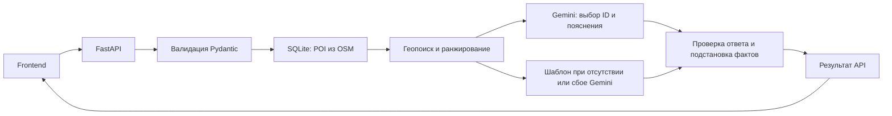

# Smart City AI — RAG-гид по Астане

Smart City AI помогает туристам и жителям выбрать реальные места Астаны по выбранной точке, пожеланию и доступному времени. Проект подготовлен для хакатона **Build with AI**, кейс **НИЦ Smart City**: факты берутся из OpenStreetMap, пояснения — из Google Gemini либо явно обозначенных шаблонов.

> Проверено по текущему коду и тестам **19 октября 2026 года**. Этот новый основной обзор сохранён под именем `README_MAIN.md`, поскольку существующие `README.md` и `backend/README.md` должны остаться без изменений.

## 1. Статус проекта

| Состояние | Что действительно работает |
| --- | --- |
| Реализовано и покрыто тестами | FastAPI: рекомендации, health, строгая валидация, единый формат ошибок, CORS; SQLite и сборщик Overpass с кешем, повторными попытками и upsert |
| Реализовано и покрыто тестами | Геопоиск, категории и ранжирование; до трёх альтернатив за ответ; один вариант с минимальной оценкой общего времени, если до него можно дойти в бюджет, с предупреждением о превышении времени посещения |
| Реализовано и покрыто тестами | Gemini REST API, проверка ID и формата ответа, консервативный фильтр неподтверждённых утверждений, шаблонные пояснения при сбое |
| Реализовано и покрыто тестами | `exclude_ids` / `has_more`, кнопка «Показать ещё», добавление карточек без повторов, повтор после ошибки и защита от запоздалых ответов предыдущего поиска |
| Реализовано и покрыто тестами | Часы OSM и `is_open_now`, маркировка неизвестного статуса и источника текста, `query_context`, исходные контакты и `wheelchair`, отсев технических названий |
| Реализовано | Frontend: форма поиска, выбор точки и ручной ввод, карта и снимок POI, карточки и подробности, RU / KZ / EN, mock-сценарии, локальные SVG-иллюстрации категорий |
| Частично | Ответы API на `ru` / `kk`; полноценного распознавания казахских намерений нет. EN относится к интерфейсу: запрос отправляется как `ru`, о чём сообщается пользователю |
| Частично | Доступность места — только сведения OSM `wheelchair` / `accessibility`, без независимой проверки и без серверного фильтра особых потребностей |
| Частично | Геолокация по кнопке, разрешение браузера и пояснения в форме есть; отдельная страница приватности и полный экран согласия запланированы |
| Не реализовано | API `GET /api/poi`, английский язык ответа API, подтверждённые маршруты и учёт транспорта кроме ходьбы, реальные фотографии локаций, загрузка сведений Wikipedia/Wikidata |
| Не реализовано в демоверсии | Аккаунты, профили и история запросов, серверный rate limiting, готовое production-развёртывание и HTTPS на локальном сервере |

При аудите рабочая SQLite и снимок карты содержали **601 место**. Ранее их было 602: один объект с кодоподобным именем исключён; количество после нового сбора может измениться. Снимок включён в репозиторий, рабочая SQLite и её резервная копия — локальные игнорируемые файлы.

## 2. Архитектура



Сборщик отдельно загружает OSM-данные через Overpass. Сам запрос рекомендаций ищет места в локальной базе: это retrieval с географией и скорингом, без векторной базы и embeddings. Gemini получает до 12 кандидатов; сервер возвращает не более трёх альтернатив. Проверка `has_more` повторяет только поиск оставшихся POI, без второго вызова Gemini.

## 3. Технологический стек

- Python **3.11+**; проверенное окружение — **3.12.14**.
- FastAPI, Pydantic 2, pydantic-settings, Uvicorn; стандартный модуль `sqlite3`.
- `opening-hours-py` и `tzdata` для расписаний OSM и часового пояса Астаны.
- Overpass API / OpenStreetMap; Gemini REST API через стандартный `urllib`, без Gemini SDK.
- Frontend: HTML, CSS и обычный JavaScript без сборщика и npm-зависимостей для запуска; Leaflet, тайлы OSM и интеграция Google Maps.
- Внешние виджеты: Open-Meteo и GDELT; Google Fonts и cdnjs для ресурсов интерфейса.
- Проверки: pytest, `httpx2`, Ruff; встроенный `node:test` для frontend. Node.js требуется для JS-тестов, но не для запуска сайта; проверено с **24.19.0**.

Версии воспроизводимого окружения закреплены в [backend/requirements-lock.txt](backend/requirements-lock.txt). Диапазоны зависимостей — в [requirements.txt](backend/requirements.txt) и [requirements-dev.txt](backend/requirements-dev.txt).

## 4. Установка и запуск

Все команды выполняются **из корня репозитория**. Нужны Git и Python 3.11+ с `venv` и `pip`; для полного набора тестов также Node.js. Для первого сбора необходим доступ к Overpass, для Gemini — доступ к Google и собственный действующий ключ. Без ключа доступны реальные POI с шаблонными пояснениями.

### 4.1. Получить проект

```sh
git clone https://github.com/kasestuck/SmartCityAI.git
cd SmartCityAI
git switch main
```

### 4.2. Создать окружение и установить зависимости

Windows PowerShell, без активации окружения:

```powershell
python --version
python -m venv .venv
.\.venv\Scripts\python.exe -m pip install -r backend/requirements-lock.txt
```

Linux/macOS:

```sh
python3 --version
python3 -m venv .venv
./.venv/bin/python -m pip install -r backend/requirements-lock.txt
```

Lock-файл включает runtime и инструменты разработки; именно эти версии проверены на Python 3.12. Если нужен подбор совместимых версий по диапазонам, вместо lock-файла используйте `backend/requirements-dev.txt`. На другой ОС результат установки и пропуски платформенных тестов могут отличаться.

Если `python` / `python3` не найден, установите Python и откройте новый терминал. На Windows можно использовать `py -3.12` вместо `python` только если Python Launcher действительно установлен. Ошибка первой команды создания окружения означает, что последующие команды `.venv` ещё выполнять нельзя.

### 4.3. Настроить окружение backend

Скопируйте пример, только если собственного файла ещё нет.

PowerShell:

```powershell
if (-not (Test-Path backend/.env)) {
    Copy-Item backend/.env.example backend/.env
}
```

Linux/macOS:

```sh
[ -f backend/.env ] || cp backend/.env.example backend/.env
```

Основные настройки уже присутствуют в [backend/.env.example](backend/.env.example):

```dotenv
DATABASE_PATH=data/poi.sqlite3
CORS_ORIGINS=["http://localhost:5173"]
GEMINI_API_KEY=
GEMINI_MODEL=gemini-3.8-flash
GEMINI_TIMEOUT_SECONDS=8
```

При необходимости заполните `GEMINI_API_KEY` **только в `backend/.env`**. Пустое значение включает шаблонный сценарий. `GEMINI_MODEL` выше — значение текущего примера; доступность модели и квота зависят от аккаунта провайдера. Ключ нельзя добавлять в JavaScript или Git. `.env`, SQLite и кеш исключены через `.gitignore`; переменные процесса имеют приоритет над `.env`.

`DATABASE_PATH` и `POI_CACHE_PATH` разрешаются относительно `backend/`, а не текущего каталога терминала. Параметры Overpass, прямоугольник Астаны и кеш на 24 часа также заданы в `.env.example`.

### 4.4. Собрать реальные POI

PowerShell:

```powershell
.\.venv\Scripts\python.exe -m backend.scripts.collect_poi
```

Linux/macOS:

```sh
./.venv/bin/python -m backend.scripts.collect_poi
```

Команда создаёт SQLite, загружает данные или использует свежий кеш и выводит `received`, `saved`, `skipped`. Для принудительного обновления добавьте `--force`. Технические имена и объекты без допустимого `name` / `name:ru` / `name:kk` / `name:en` пропускаются. После сборки ожидается непустая база, но фиксированное число мест не гарантируется: OSM изменяется, Overpass может временно отказать.

Карта «Все места» использует отдельный включённый файл `data/poi-astana.json`. Он не обновляется автоматически при сборе SQLite. При необходимости обновите его отдельной командой `python tools/build_poi_snapshot.py` через выбранный интерпретатор `.venv`; эта команда тоже обращается к Overpass. Обе процедуры используют общую политику допустимых названий.

### 4.5. Запустить API

Текущий `API_BASE_URL` в [js/config.js](js/config.js) — **`http://localhost:8001`**. Поэтому запускайте backend на `8001`.

PowerShell:

```powershell
.\.venv\Scripts\python.exe -m uvicorn backend.main:app --host 127.0.0.1 --port 8001 --no-access-log
```

Linux/macOS:

```sh
./.venv/bin/python -m uvicorn backend.main:app --host 127.0.0.1 --port 8001 --no-access-log
```

Оставьте терминал открытым. При выборе другого порта одновременно измените `API_BASE_URL` во frontend. `--no-access-log` отключает access log Uvicorn, но не журналы других серверов или инфраструктуры.

Если локальная среда выдаёт `PermissionError`, связанный с унаследованной переменной `SSLKEYLOGFILE`, в текущем PowerShell можно выполнить `$env:SSLKEYLOGFILE=$null` и повторить команду. Это отключает путь к отладочному журналу TLS в этом процессе и не меняет ключ Gemini или `.env`.

### 4.6. Проверить API

В другом терминале PowerShell:

```powershell
Invoke-RestMethod http://localhost:8001/api/health

$body = @{
    latitude = 51.1605
    longitude = 71.4704
    query = 'Кофе рядом'
    duration_minutes = 60
    transport = 'walking'
    categories = @('cafe')
    language = 'ru'
    exclude_ids = @()
} | ConvertTo-Json

Invoke-RestMethod -Uri http://localhost:8001/api/recommendations -Method Post -ContentType 'application/json; charset=utf-8' -Body ([System.Text.Encoding]::UTF8.GetBytes($body))
```

Linux/macOS:

```sh
curl -sS http://localhost:8001/api/health
curl -sS http://localhost:8001/api/recommendations \
  -H 'Content-Type: application/json' \
  -d '{"latitude":51.1605,"longitude":71.4704,"query":"Кофе рядом","duration_minutes":60,"transport":"walking","categories":["cafe"],"language":"ru","exclude_ids":[]}'
```

Health возвращает `{"status":"ok"}` при доступной таблице POI. Это **не проверка ключа Gemini и не гарантия непустой базы**. Рекомендации возвращаются с `query_context`, `language`, `has_more`; `generated_by` каждой карточки показывает `gemini` или `fallback_template`. HTTP 200 сам по себе не подтверждает использование AI. Пустой результат при отсутствии подходящих мест допустим.

Swagger UI: [http://localhost:8001/docs](http://localhost:8001/docs). OpenAPI: [http://localhost:8001/openapi.json](http://localhost:8001/openapi.json).

### 4.7. Запустить frontend

Во втором терминале, из того же корня репозитория:

```powershell
.\.venv\Scripts\python.exe tools/serve_frontend.py
```

Либо Linux/macOS:

```sh
./.venv/bin/python tools/serve_frontend.py
```

Откройте **[http://localhost:5173](http://localhost:5173)**. Именно этот origin разрешён примером CORS; `127.0.0.1:5173` — другой origin. Для геолокации нажмите соответствующую кнопку или выберите центр, ориентир, карту либо ручные координаты.

Используйте предоставленный сервер: он отдаёт только публичные frontend-файлы и не открывает доступ к `backend/.env`, SQLite или `.git`. Не запускайте общий `python -m http.server` из корня объединённого проекта.

Для демонстрации интерфейса без backend есть [mock-режим](http://localhost:5173/?mock=1#/guide). Он использует тестовые ответы и не подтверждает работу SQLite или Gemini. После изменения кода перезапустите backend и обновите страницу без кеша (`Ctrl+F5`).

## 5. API

| Метод и путь | Назначение |
| --- | --- |
| `GET /api/health` | Проверка доступности SQLite/таблицы POI |
| `POST /api/recommendations` | От 0 до 3 рекомендаций, контекст запроса, язык и признак продолжения |
| `GET /docs`, `GET /openapi.json` | Интерактивная документация и схема API |

Обязательные поля запроса: `latitude`, `longitude`, `query`, `duration_minutes`, `transport`. Поддерживаются `walking`, 15–240 минут, запрос 1–500 символов; необязательны `categories`, `language` (`ru`/`kk`) и `exclude_ids`. Для следующей порции передавайте ID **всех** показанных карточек; продолжайте, пока `has_more=true`. Неизвестные поля и неподходящие типы получают HTTP 422 в общем формате ошибок.

Полный контракт, категории, ограничения исключений и поля карточки: [docs/api-contract.md](docs/api-contract.md). `image_url` обозначает локальную иконку категории, а не фотографию. `GET /api/poi` в текущем backend отсутствует.

## 6. Тестирование

PowerShell:

```powershell
.\.venv\Scripts\python.exe -m pytest -q
.\.venv\Scripts\python.exe -m ruff check backend tools
.\.venv\Scripts\python.exe -m ruff format --check backend tools
node --test tests/frontend-contract.test.cjs
```

Linux/macOS: замените `.\.venv\Scripts\python.exe` на `./.venv/bin/python`; команда Node остаётся той же.

Свежий запуск **19.10.2026**: **435 Python-тестов прошли, 8 пропущены**, **26 frontend-тестов прошли**. Пропуски — существующие проверки символических ссылок: у проверенного Windows-окружения нет права их создавать (`WinError 1314`). Для обхода ограничений стандартного временного каталога при проверке использовались `-p no:cacheprovider --basetemp <отдельный-временный-каталог>`; выбирайте новый каталог, который pytest может создавать и очищать.

Тесты проверяют валидацию, ошибки/CORS, SQLite и сборщик, геопоиск, Gemini с контролируемыми ответами, часы, названия, пагинацию, источники и безопасную раздачу frontend. JS-тесты проверяют контракт, форму, языки, подгрузку, ошибки и иконки. Они не доказывают доступность внешних сервисов или текущую квоту Gemini.

В [demo-results.json](docs/demo-results.json) сохранены результаты прежних живых запросов Gemini, включая казахский сценарий от 18.10.2026. При подготовке этого README новые запросы к Gemini и Overpass не выполнялись.

## 7. Известные ограничения

- OSM может быть неполной или устаревшей; покрытие ограничено прямоугольником и семью категориями. Контакты и доступность не проверяются на месте. Объекты, исчезнувшие из нового ответа OSM, автоматически из SQLite не удаляются.
- Расстояние — по прямой; время — эвристика ходьбы и посещения, без обратной дороги. Карточки являются альтернативами, а не маршрутом из нескольких посещений.
- `is_open_now` описывает расписание OSM в `Asia/Almaty`. Неизвестные/неподдержанные часы дают `null`; фактическая работа не подтверждается. Закрытые по расписанию места остаются в выдаче.
- Белый список ID не доказывает истинность каждой фразы модели; фильтр технических названий также является эвристикой.
- Казахская генерация и шаблоны есть, но отдельного распознавания казахских намерений нет. Английский ответ API и серверный фильтр особых потребностей не реализованы.
- Изображения — локальные иллюстрации категорий. Карты, шрифты, погода и новости зависят от внешних ресурсов; полный офлайн-режим не реализован.
- Утверждение «координаты не сохраняются» относится к логике приложения, а не ко всем возможным журналам браузера, провайдеров или хостинга.

Подробности: [docs/limitations.md](docs/limitations.md), [этические и privacy-заметки v2](docs/ethics-and-privacy-v2.md).

## 8. Структура проекта

```text
SmartCityAI/
├── README_MAIN.md                 # Этот обзор
├── README.md                      # Сохранённая прежняя инструкция
├── index.html, styleguide.html
├── js/, css/, assets/             # Frontend и локальные иконки
├── data/poi-astana.json            # Публичный снимок POI для карты
├── backend/
│   ├── main.py, config.py, schemas.py, errors.py
│   ├── routes/, database/, services/
│   ├── scripts/                   # Сборщик и аудит названий
│   ├── tests/
│   ├── .env.example
│   ├── requirements*.txt
│   ├── README.md                  # Существующая backend-инструкция
│   └── data/, cache/              # Локальные данные, не входят в Git
├── tools/                         # Публичный сервер и генератор снимка
├── tests/frontend-contract.test.cjs
└── docs/                          # Контракт, ограничения, отчёты, сдача
```

## 9. Документация

- [API-контракт](docs/api-contract.md).
- [Этические и privacy-заметки v2](docs/ethics-and-privacy-v2.md); [сохранённая прежняя версия](docs/ethics-and-privacy.md).
- [Ограничения](docs/limitations.md) и [тестовые сценарии](docs/test-scenarios.md).
- [Проверки Gemini](docs/demo-results.json).
- [Аудит названий](docs/name-quality-audit.json) и [отчёт о пагинации и иллюстрациях](docs/recommendations-update.md).
- [Материалы для сдачи](docs/submission/).
- [Сохранённая backend-инструкция](backend/README.md); её отличия от текущего запуска отмечены ниже.

Атрибуция данных: **© OpenStreetMap contributors**, [OpenStreetMap / ODbL](https://www.openstreetmap.org/copyright).

## 10. Команда

- Backend: **[ЗАПОЛНИТЬ]**.
- Frontend: **[ЗАПОЛНИТЬ]**.
- Контакт команды: **[ЗАПОЛНИТЬ]**.

## 11. Расхождения, требующие внимания

1. **Порт API.** Сохранённые `README.md` и `backend/README.md` описывают `8000`; текущий `js/config.js` использует `8001`. Команды этого документа согласованы с текущим кодом. Старые файлы намеренно не исправлялись.
2. **Число POI.** Упоминание 602 в прежнем README относится к сбору до очистки. Текущие SQLite и снимок содержат 601; удалён один кодоподобный заголовок, исходная SQLite сохранена в локальной резервной копии.
3. **Языки и доступность.** RU / KZ / EN в интерфейсе не означают три языка API. Сервер принимает только `ru` и `kk`; `accessibility` поддерживается в ответе, но не как фильтр запроса. Эти ограничения видны в UI и тестах.
4. **Карты и фото.** Слой «Все места» берёт статический снимок, поскольку `GET /api/poi` отсутствует. Наличие `image_url` не означает реальные фото: отображаются SVG-категории.
5. **Приватность.** Полный текст согласия из прежнего отчёта остаётся планом; реализованы пояснения формы и разрешение браузера. Нет оснований обещать отсутствие всех технических журналов или юридическое соответствие только по наличию `.env` и CORS.
6. **Публикация версии.** На момент начала аудита локальная `main` имела восемь неопубликованных коммитов, а изменения названий, пагинации и иллюстраций ещё находились в рабочем дереве. Новый README описывает именно проверенный код. До публикации этой версии клонирование прежней удалённой `main` не воспроизводит описанное состояние; публикация должна включать соответствующий код, а не только документацию.
