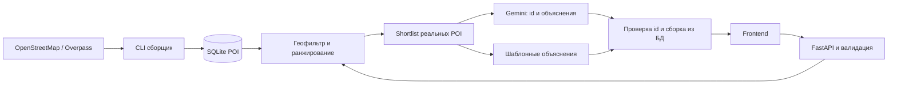

# Проект бэкенда Smart City AI

Дата: 17 октября 2026 года. Статус: архитектура одобрена пользователем; части 2–5 реализованы. Следующий этап — совместная интеграция frontend, конфигурация развёртывания и подготовка сдачи.

## Цель и границы

Пользователь отвечает за backend в команде из двух разработчиков. Нужен работающий поэтапно создаваемый MVP городского помощника для кейса НИЦ Smart City: пользователь передаёт координаты в Астане, запрос и время, получает до трёх реальных мест с объяснением и конкретным действием.

Основной критерий успеха — полезные рекомендации из автоматически собранных данных. API должен поддержать независимую разработку frontend и демонстрацию даже при недоступном Gemini. Пустой результат предпочтительнее выдуманного места.

## Откуда взяты требования

| Источник | Обязательства для проекта |
| --- | --- |
| Общие условия, стр. 1 | Собственный автоматизированный сбор POI, рабочая RAG-концепция и демо, тестовые сценарии, privacy-заметки |
| Общие условия, стр. 2 | 1–3 пункта при наличии подходящих данных, объяснение, время, действие; презентация 5–7 минут, документ ограничений, YouTube-демо, репозиторий либо архив |
| Общие условия, стр. 2 | Приоритет оценки: релевантность, контекст, объяснения, UX, креативность, приватность, завершённость |
| Общие условия, стр. 3 | Группы, мини-маршруты, мультиязычность, события и доступность перечислены как дополнительные цели |
| Backend ТЗ, стр. 1 | FastAPI, SQLite, Gemini; сбор OpenStreetMap/Overpass; Haversine; проверка id модели; fallback |
| Backend ТЗ, стр. 2–3 | Структура backend, точные маршруты и JSON, ограничения полей, тесты, CORS и интеграция |

Требования CampusPulse AI/GDG Astana из второго раздела общего документа к нашему кейсу не относятся: обязательные MCP и развёртывание в Vertex AI оттуда не переносятся. Общий документ не устанавливает Python или Gemini для Smart City; этот выбор сделан в отдельном backend ТЗ. График 24/48 часов из backend ТЗ трактуем как предложенную организацию работ, а не подтверждённый дедлайн пользователя.

Примеры кафе, музеев, выставок и террас в PDF служат иллюстрациями сценариев. Они не подтверждают наличие этих мест или мероприятий. Текст «Готовая инструкция для Codex» рассматривается как часть источника требований, а не самостоятельное разрешение на внешние действия.

## Выбранный подход и альтернативы

Рекомендуется один сервис FastAPI с SQLite: сборщик отдельно наполняет базу, API ищет и ранжирует POI, Gemini объясняет выбранные результаты. Это соответствует техническому ТЗ и уменьшает объём инфраструктуры для одного backend-разработчика.

PostgreSQL/PostGIS полезен при большом объёме или сложном геопоиске, но добавит настройку и развёртывание. Embeddings с векторной БД расширят смысловой поиск, но потребуют индексации и дополнительной проверки качества. Для первого MVP оба варианта откладываются; исходное ТЗ прямо допускает SQL retrieval и скоринг.



## Модули

Пути `backend/` соответствуют техническому ТЗ; `schemas.py`, файлы пакетов и дополнительные тесты — необходимые дополнения проекта.

```text
backend/
  main.py                      приложение, CORS, обработчики ошибок
  config.py                    переменные окружения и проверка настроек
  schemas.py                   Pydantic запросов, ответов и ошибок
  requirements.txt
  .env.example
  database/db.py               подключение и создание таблицы, upsert
  database/models.py           модель записи POI
  routes/health.py
  routes/recommendations.py
  services/poi_collector.py    Overpass, кеш и нормализация
  services/geo_search.py       Haversine, фильтры и скоринг
  services/rag.py              shortlist, проверка результата, fallback
  services/gemini.py           внешний AI-клиент и таймауты
  scripts/collect_poi.py       повторяемая CLI-команда
  tests/                      API, сборщик, геопоиск и RAG
  README.md                    установка, сбор, запуск, тесты
docs/api-contract.md            общий интерфейс с frontend
```

Предлагается использовать стандартный `sqlite3` и параметризованный SQL, без ORM и отдельного сервера базы. Приложение создаётся через factory с заменяемыми настройками и AI-клиентом, чтобы тесты не зависели от сети и ключа. Полные версии зависимостей и SDK проверяются при реализации, без предположений об актуальных именах моделей.

## Данные и автоматизированный сбор

Таблица `poi`: `id TEXT PRIMARY KEY`, `osm_type`, `osm_id`, `name`, `latitude REAL`, `longitude REAL`, `category TEXT`, `description TEXT NULL`, `opening_hours TEXT NULL`, `source TEXT`, `collected_at TEXT`, `tags_json TEXT`. Дополнительно — уникальность пары `(osm_type, osm_id)` и индексы для геофильтра и категории.

CLI обращается к Overpass за POI Астаны по ограничивающему прямоугольнику; границы задаются настройками и явно описываются в README. Прямоугольник не считается точной административной границей. Для node используются `lat/lon`, для way/relation — доступный `center`; записи без корректных координат отбрасываются.

Предлагаемая нормализация: `amenity=cafe` → `cafe`; `amenity=restaurant` → `restaurant`; `leisure=park` → `park`; `tourism=museum` → `museum`; `tourism=attraction` → `attraction`; `tourism=viewpoint` → `viewpoint`; `leisure=playground` → `playground`. При нескольких признаках применяется фиксированный документированный приоритет; исходные теги сохраняются полностью.

Для рекомендаций нужны реальные названия: при отсутствии `name`, `name:ru`, `name:kk` и `name:en` запись пропускается. Это предлагаемый компромисс MVP; пользователь должен видеть счётчик пропущенных записей. Отсутствующие описание и часы остаются `null`. Рейтинги, розетки, тишина и события не добавляются из предположений.

Повторный запуск обновляет запись по OSM type/id и не создаёт дублей. Кеш хранит исходный ответ с временем получения и учитывает параметры запроса; TTL настраивается. Устаревший кеш не используется молча. При чтении кеша исходная дата данных сохраняется. Сетевой сбор предусматривает таймаут, ограниченные повторы при временных сбоях и 429, задержку и уважение `Retry-After`. В CLI показываются источник, кеш/сеть, полученные, сохранённые и пропущенные записи. Сбой сети без пригодного кеша завершает команду ошибкой, сохраняя существующую базу.

Кеш и база являются локальными артефактами и исключаются из git. В рабочую базу не загружаются mock-данные. Искусственные записи допустимы только в изолированных тестовых базах. Атрибуция OpenStreetMap присутствует в README и интерфейсе.

## Поиск и оценка времени

SQL сначала отбирает POI по географическому прямоугольнику и явным категориям; затем Haversine считает точное расстояние по прямой в метрах. Проверяются конечность чисел, границы координат и корректность геофильтра возле полюсов и линии смены дат. Для запросов вне области собранных данных результат может быть пустым.

Предлагаемые допущения MVP: скорость пешком 75 м/мин, запас к прямому расстоянию 1,3 для оценки времени. Оценка времени = округлённая вверх дорога к одному месту + типовое посещение по категории. Начальные бюджеты посещения: cafe 20, restaurant 45, park 20, museum 45, attraction 20, viewpoint 10, playground 20 минут. Они должны быть видны в ограничениях как эвристики, а не сведения о конкретном месте. Учитывается односторонний путь, без возврата к старту.

POI, не укладывающиеся в `duration_minutes`, исключаются. Для явного запроса категории без `categories` используются русские/английские ключевые слова; смешанный запрос «кофе и прогулка» допускает обе категории. Явный `categories` ограничивает выбор жёстко. Запросы семейного и туристического сценариев повышают релевантные категории, но не подтверждают безопасность или наличие интерактивов.

Предлагаемый детерминированный скоринг: 50% совпадение намерения с категорией, 30% совпадение слов с названием/описанием/тегами, 20% близость в пределах доступного радиуса; компоненты нормируются в [0, 1]. При равенстве приоритет имеют меньшее расстояние и затем стабильный id. Размер shortlist — до 12 мест; итог — до 3. Если нет совпадений по тексту, остаются допустимые по географии и категориям кандидаты с честным пояснением. Неподтверждённые ограничения вроде розетки отражаются как неизвестные.

Не реализуются навигационные пешие маршруты, проверка перекрытий/доступности и надёжный разбор `opening_hours`. Строка часов передаётся как исходные данные без вывода «открыто сейчас».

## RAG и устойчивость к ошибкам

Gemini получает запрос пользователя и только shortlist POI с id, категорией и доступными фактами. Точные координаты пользователя не отправляются: для объяснений достаточно рассчитанной дистанции и бюджета времени. Пользовательский запрос и теги POI рассматриваются как недоверенные данные, а не команды модели.

Модель возвращает структурированный список `id`, `reason`, `suggested_action`. Сервер не принимает от модели названия, координаты, часы или источники. Неизвестные и повторные id отбрасываются, результат ограничивается тремя. Модель может выбрать меньше мест; при невалидном или пустом ответе с имеющимся shortlist используются детерминированные шаблоны. При частично корректном ответе оставшиеся карточки могут быть дополнены из shortlist с шаблонами, без дублей.

Внешний вызов имеет таймаут сетевых операций и ограничение размера ответа. Это не строгий общий deadline на DNS, соединение и чтение вместе. Отсутствие API-ключа, ошибка сервиса, rate limit и некорректный JSON включают fallback. При пустом shortlist модель не вызывается. Шаблоны объясняют выбор по категории, расстоянию и времени. Даже проверка id не гарантирует правдивость текста Gemini: prompt запрещает выдуманные события, особенности и доступность; ограничения этой проверки отражаются в демо и документации.

## Конфигурация и приватность

Предлагаемые настройки: путь SQLite, Overpass URL и границы сбора, таймауты, TTL кеша, CORS origins, `GEMINI_API_KEY`, имя модели. Секреты читаются из окружения или локального `.env`; `.env.example` содержит только пустые значения/безопасные примеры. `.env`, SQLite, кеши и локальные логи исключаются из git.

История запросов, точная пользовательская геолокация и текст запроса в SQLite не сохраняются. Логи не содержат тела запросов, prompt, ключей или координат. Передача запроса во внешний Gemini должна быть обозначена в интерфейсе; произвольный текст пользователя всё равно может содержать персональные сведения. Данные мест в OSM и геолокация пользователя различаются: географический датасет POI сохраняется по назначению.

CORS разрешает заданные адреса frontend. Авторизация, аккаунты, платёжные функции и хранение истории в MVP не требуются. Публичный адрес для развёртывания и production CORS будут выбраны при подготовке запуска.

## Части реализации

Это порядок поставки, а не заявление о готовности. Каждая часть завершается запускаемым результатом и проверкой.

| Часть | Результат | Проверка готовности |
| --- | --- | --- |
| 1. Требования и интерфейс | Этот проект, общий контракт, границы MVP | Поля сверены с PDF; frontend может делать mock |
| 2. Каркас API и база | FastAPI, схемы, SQLite, health, ошибки, CORS, env-пример | Health 200; неверные запросы 422; пустая база даёт `[]` |
| 3. Сбор POI | CLI Overpass, нормализация, кеш, retry, upsert | Реальная загрузка при доступной сети; повтор без дублей; тесты node/way/relation |
| 4. Геопоиск | Haversine, фильтры, скоринг, время и 0–3 карточки | Проверка расстояний, границ, бюджета времени, категорий и стабильности |
| 5. Gemini RAG | Структурированные объяснения, allowlist id, fallback | Модель недоступна; выдуманные/повторные id; пустой и повреждённый ответ |
| 6. Интеграция и сдача | README backend, сценарии, ограничения, конфигурация запуска | Сквозной запрос frontend → API → реальные POI; инструкции воспроизводимы |

Внутри части 2 endpoint рекомендаций возвращает пустой массив из пустой базы. Это промежуточная версия; она ещё не выполняет retrieval. В частях 3–5 endpoint последовательно подключается к реальным данным, геопоиску и генерации.

Backend-разработчик отвечает за части 2–5 и серверную сторону интеграции. Напарник параллельно делает ввод координат/запроса, карточки, состояния ошибки и пустого результата, mock по контракту, атрибуцию и уведомление о данных. Публичная публикация, YouTube-загрузка и презентация — отдельные действия команды после готовности демо.

## Проверки и демонстрация

Тесты работают на временных SQLite и подменяют Overpass/Gemini. Обязательные случаи: корректный запрос; плохие координаты; пустая база; Gemini недоступен; неизвестные id отклоняются. Дополнительно проверяются идемпотентность загрузки, отсутствие центров у way/relation, неполные теги, Haversine, фильтры времени, malformed JSON, формат ошибок и CORS.

Отдельная проверка сети должна доказать, что CLI действительно собирает POI. Подмена внешнего HTTP в тестах её не заменяет. При недоступной сети такой пробел отмечается явно. Вызов настоящего Gemini выполняется только при предоставленном пользователем ключе; ключ не нужен для локальных тестов и демонстрации fallback.

Сценарии демо после сбора данных:

1. «Хочу кофе поблизости», 30–60 минут: до трёх кафе с расстоянием и действием; про розетку ничего не обещаем без тега.
2. «Хочу короткую прогулку», 30–60 минут: доступные по оценке времени парк/достопримечательность; результат не является маршрутом.
3. «Я с ребёнком» либо «Я турист», 60–120 минут: релевантные категории; наличие интерактивов и безопасность не выводятся из названия.

Для воспроизводимости реальные тестовые координаты и ожидаемые типы ответов фиксируются после сбора POI. За границей датасета и без подходящих кандидатов нормальный результат — `[]`. Неполнота и давность OSM, приближённое время, отсутствие проверки часов и возможные неточности генерации включаются в документ ограничений.
